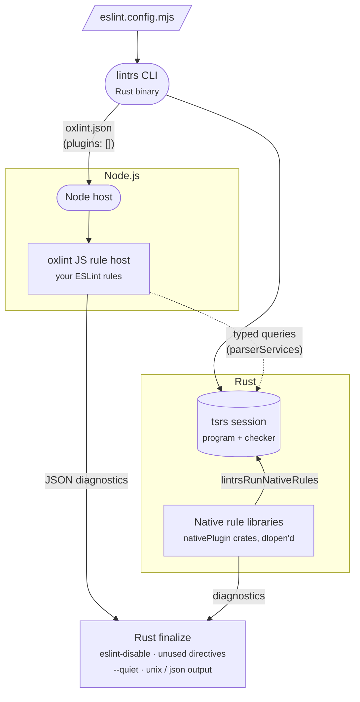

# How it works

- **Parsing.** oxc parses each file once. The ESTree AST goes to oxlint's
  rule host; rules run unchanged, with fixes, suggestions, selectors, scopes
  and code paths. Syntax-only runs create no checker.
- **Types.** `parserServices` holds the program, node maps and a checker
  proxied to tsrs. Queries batch by node kind per file; caches live until the
  project's last file.
- **Dependencies.** Resolved from prebuilt declarations, not sources.
  Listing `Program.getSourceFiles()` filenames fetches no ASTs.
- **Native rules.** `dlopen`ed libraries link against the shared `liblintrs`:
  one copy of lintrs and tsrs, verified by the ABI fingerprint and a probe
  static.
- **Reporting.** JS and Rust diagnostics share one finalize step:
  `eslint-disable`, unused directives, `--quiet`, output.
